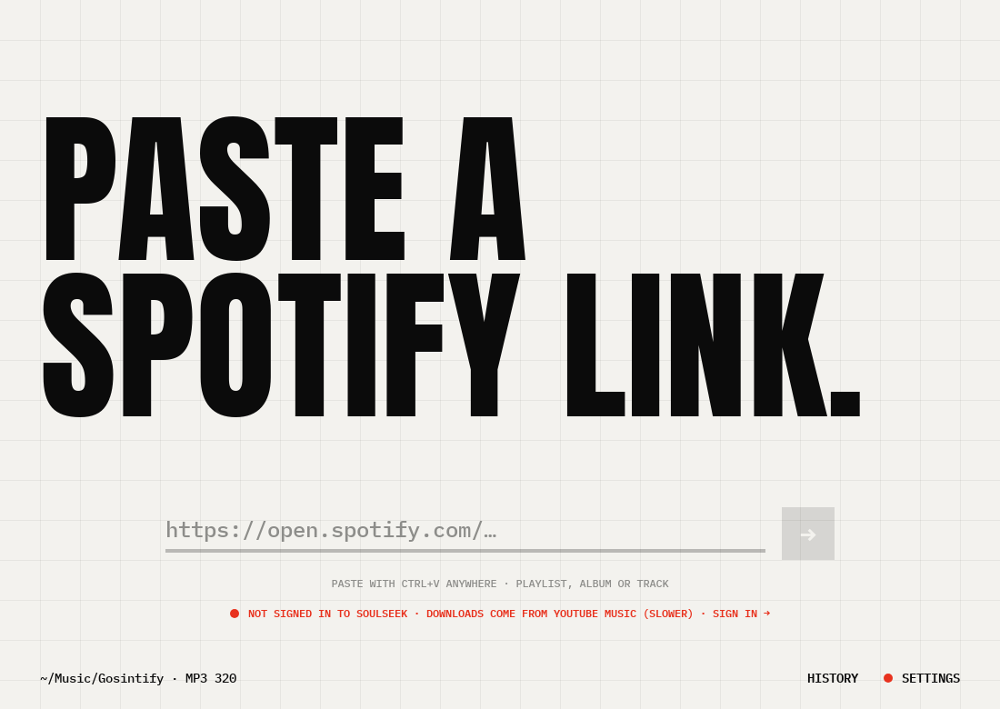
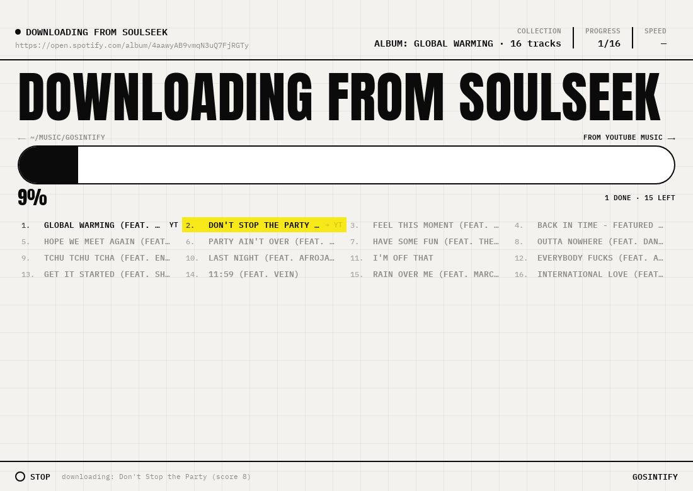
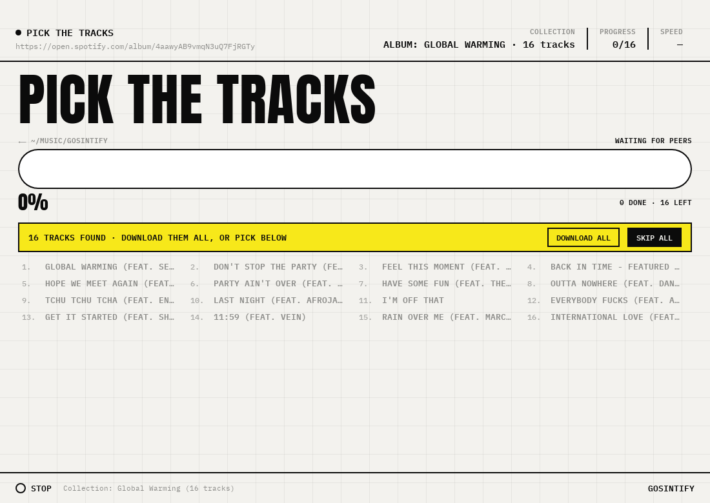
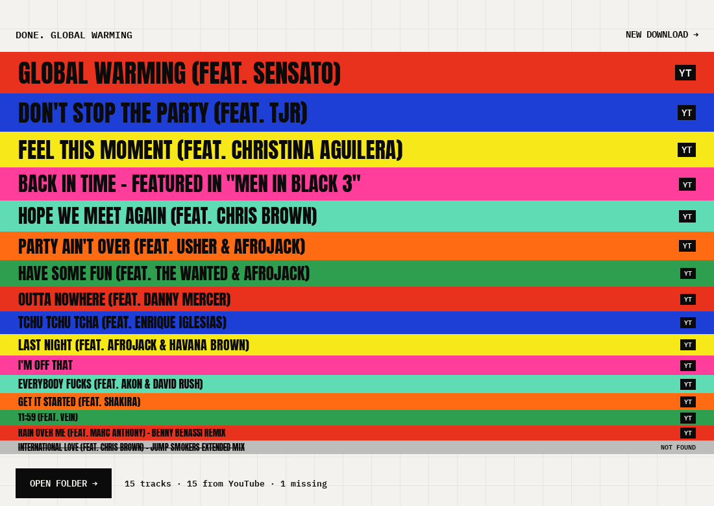
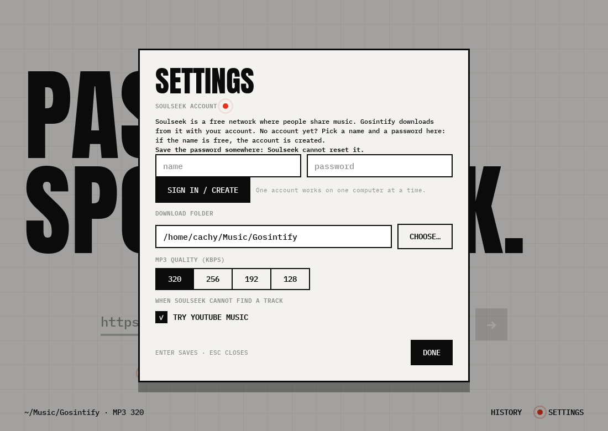

<div align="center">


# Gosintify

**Paste a Spotify link. Get mp3 files. Soulseek first, YouTube Music for the gaps.**

A small desktop app that turns a public Spotify playlist, album or track into
mp3s at the bitrate you pick — with a window that is a sheet of graph paper, not
a settings dialog.

[](https://go.dev)
[](https://github.com/egoist/mygo)
[](./LICENSE)
[](#install)

[Why Gosintify](#why-gosintify) · [Screenshots](#screenshots) · [Features](#features) · [Install](#install) · [How it works](#how-it-works) · [Build](#build-and-run) · [Credits](#credits)

</div>

---

## Why Gosintify

Spotify deleted your downloaded library and the music you paid for in 2012 lives
on a hard drive you no longer own. Gosintify is one answer to that: point it at a
public link, and it puts real files back on your disk.

- **Files, not a library you rent.** Every track lands as an mp3 you can copy,
  tag, back up or play in any player, forever.
- **Soulseek first.** Real files from real people beat a re-encode of a YouTube
  stream. Soulseek is tried for every track; only the gaps fall through.
- **The gaps are not silent.** What Soulseek cannot find, YouTube Music fills —
  ranked so that lyrics videos, covers, karaoke, live takes and remixes stay out.
- **Never FLAC.** Everything is normalized to mp3 at the bitrate you chose, with
  the cover embedded.
- **A window you can look at.** Warm paper, a faint grid, Anton for the words
  that matter, and a poster of stripes when an album is done.

## Screenshots

**Paste a link.** One field, one button, and the footer says where the files go:

[](./docs/screenshots/idle.png)

**Watch it work.** Every track reports its own state — searching, downloading
with its percentage, then the stripe colour of the poster:

[](./docs/screenshots/downloading.png)

**Long lists pause to ask.** With *Download everything without asking* off, the
list comes back and you choose; a countdown skips what you already have:

[](./docs/screenshots/working.png)

**The poster.** The album painted in stripes, biggest first, YouTube tracks
tagged `YT`, the ones that never arrived struck through:

[](./docs/screenshots/poster.png)

**Settings.** The Soulseek account, the folder, the bitrate and the fallback:

[](./docs/screenshots/settings.png)

## Features

### Downloading

- **A Spotify link** — playlist, album or track, read from the public pages. No
  Spotify account, no API key, no login.
- **Soulseek** through [`sockseek`](https://github.com/lopezlav/sockseek), with
  albums downloaded as one folder and a peer's file matched to the right row
  even when it carries its own numbering.
- **YouTube Music fallback** with a relevance score over title, artist, album
  and length. A lyric video, a karaoke track, a nightcore edit or a 12-hour loop
  is rejected by name and by duration.
- **mp3 at 320 / 256 / 192 / 128 kbps**, tags and cover art embedded via ffmpeg.
- **Ask or don't ask** — with the picker on, the track list appears and waits.

### The window

- **Live per-track state**: a percentage on the row while it downloads, a red
  fill growing behind the title, `YT` when a track came from the fallback.
- **A real progress bar** over the whole run, including the mp3 conversion.
- **The poster** at the end: stripes sized by rank, the missing ones in grey.
- **History** of every finished download, by link, with a folder shortcut.
- **A log** in the footer, so a failure says what failed.

### Behaviour worth knowing

- **An invalid link fails loudly.** Spotify returning a 404 for a track gives
  `Spotify did not return track <id>: the link is wrong or the track is gone`
  instead of a run that downloads nothing.
- **A finished run stays on screen.** The poster and its track list do not
  vanish, so you can see what arrived and what did not.
- **No stray files.** A download cleans up the `.webm`, `.webp` and `.part`
  leftovers yt-dlp leaves beside the mp3.
- **Settings live in one file.** `~/.config/Gosintify` on Linux,
  `%APPDATA%\Gosintify` on Windows, `~/Library/Application Support/Gosintify` on
  macOS. `GOSINTIFY_CONFIG_DIR` overrides it.

## Install

Prebuilt apps are on the [releases page](https://github.com/agnogad/Gosintify/releases):

| Platform | Download |
| --- | --- |
| **Linux** | `gosintify-<version>-linux-<arch>.tar.gz` (unpacks with `install.sh`), or the `.deb` |
| **macOS** | `gosintify-<version>.dmg` (universal: Apple silicon and Intel) |
| **Windows** | `gosintify-setup-<version>-<arch>.exe` |

Verify a download against the release's `SHA256SUMS`.

### Linux, with the install script

```bash
tar xzf gosintify-0.1.0-linux-amd64.tar.gz
./install.sh          # installs under ~/.local and adds a menu entry
```

### The tools it runs

Gosintify does not bundle the programs it drives. They must be on your `PATH`,
and **Settings** lists which were found:

| Tool | Needed for |
| --- | --- |
| `yt-dlp` | YouTube Music search and the fallback |
| `ffmpeg`, `ffprobe` | converting everything to mp3 |
| `sockseek` | the Soulseek route (optional) |

```bash
# macOS
brew install yt-dlp ffmpeg

# Debian/Ubuntu
sudo apt install yt-dlp ffmpeg
```

Without `sockseek` the app says so and takes every track from YouTube Music;
nothing else changes.

### A Soulseek account

Soulseek has no sign-up page: signing in with a new name in **Settings →
Soulseek account** creates the account. Keep the password — Soulseek cannot
reset it.

## How it works

```
Spotify link
   │  spotify.Extract: the public page, no account
   ▼
Collection ──► Soulseek (sockseek) ──► found? ──► mp3
   │                                     │ no
   │                                     ▼
   └──────────► YouTube Music search ──► rank ──► download ──► mp3
                                           (title, artist, album, length)
```

Two goroutine-safe pieces carry it:

- **`internal/pipeline`** — the run itself: Soulseek, the fallback, the match of
  a peer's file to a track, and the mp3 normalization. It reports progress as
  structured `Event`s and never talks to the UI.
- **`Api` in `api.go`** — folds those events into a `job` and serves it through
  `GetState`. The page draws the whole run from that one snapshot, so a reload
  mid-download loses nothing.

The frontend is plain TypeScript over the typed bindings `bunx mygo generate`
writes from `api.go`.

## Build and run

### Requirements

- **Go 1.27+**
- **Bun** for the page
- The system webview: WebKitGTK 4.1 on Linux, WebView2 on Windows, WKWebView on
  macOS. MyGo needs no cgo, so every platform cross-compiles from any machine.

### From source

```bash
git clone https://github.com/agnogad/Gosintify.git
cd Gosintify
bun install
bun run dev            # mygo dev: Vite with live reload, and the app
```

`bun run dev` opens the app against the Vite server. To run the built page:

```bash
bun run build:web
go build -o /tmp/gosintify .
MYGO_FRONTEND_DIST=$PWD/dist /tmp/gosintify
```

### A packaged app

```bash
bunx mygo build -platform linux/amd64,windows/amd64,darwin/universal
```

The version comes from `version` in `mygo.config.ts`; the release workflow sets
it from the tag, so a `v0.2.0` tag publishes a `0.2.0` build. Linux gets a
`.deb`, a `.tar.gz` with `install.sh` and a `PKGBUILD`; Windows an NSIS
installer; macOS a universal `.app` in a `.dmg`.

### Testing

```bash
go test ./...          # the pipeline, the ranking, the store
go vet ./...           # static checks
gofmt -l .             # formatting
bunx tsc --noEmit      # the page
```

The suite covers track matching (a peer's `02 - Billie Jean (Underground
Mix).mp3` must not take the `Billie Jean` row), the YouTube relevance score
(lyrics, karaoke, nightcore and long loops lose to the real song), title
normalization and file naming, the settings and history store, and the Spotify
link reader.

## Repository layout

```
Gosintify/
├─ main.go               the window, and the service it binds
├─ api.go                every method the page can call
├─ tools.go              finds yt-dlp, ffmpeg and sockseek on PATH
├─ internal/
│  ├─ pipeline/          the run: Soulseek, fallback, mp3, events
│  ├─ spotify/           the public page reader and the read-only API client
│  ├─ ytdlp/             YouTube Music search, ranking and download
│  ├─ slsk/              the Soulseek sign-in check
│  └─ appstore/          settings.json and history.json
├─ src/
│  ├─ main.ts            the page: idle, working, poster, history, settings
│  ├─ style.css          the look: paper, graph paper, stripes
│  ├─ fonts/             Anton and IBM Plex Mono
│  └─ mygo.ts            generated typed client of api.go
├─ docs/screenshots/     the images in this README
└─ .github/workflows/    CI and the cross-platform release
```

## Design principles

- **The file is the result.** Nothing is reported as done until an mp3 with the
  right duration is on disk; `_report.json` next to the download says what
  happened.
- **Match before you trust.** A peer's filename is a suggestion. Scoring every
  file against every track, best pair first, keeps a remix from stealing a row.
- **Say why, not just no.** A bad link, a missing tool, a failed search: the log
  and the status line name the cause.
- **Keep the run visible.** The state of a run lives in Go, not in the page.
  Anything that draws the run can be wrong and then correct itself.

## Contributing

Issues and pull requests are welcome. Before opening a PR:

1. Run `gofmt -l .`, `go vet ./...`, `go test ./...`, `bunx tsc --noEmit`.
2. Keep the palette: paper, ink, one red, one yellow, and the poster stripes.
3. If you touch the pipeline, make sure a finished run still shows its poster.

## Credits

Gosintify is a port of **[Spotseek](https://github.com/lopezlav/spotseek)** by
[agnogad](https://github.com/lopezlav): its download pipeline, Spotify reader,
yt-dlp search and Soulseek sign-in are reused under the MIT licence, and so are
the Anton and IBM Plex Mono fonts. Built with
**[MyGo](https://github.com/egoist/mygo)**.

## License

Released under the [MIT License](./LICENSE). Copyright © 2026 Gosintify contributors.

<div align="center">

Made for keeping the music you already paid for.

</div>
